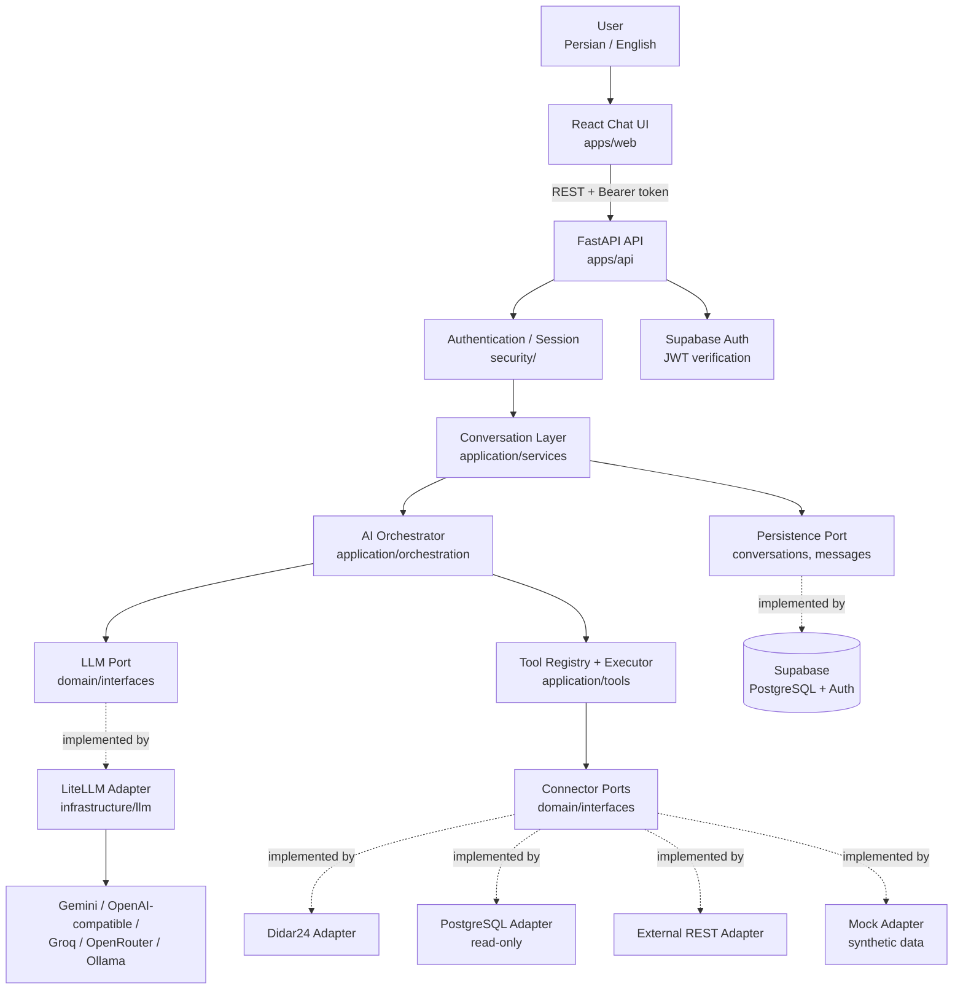
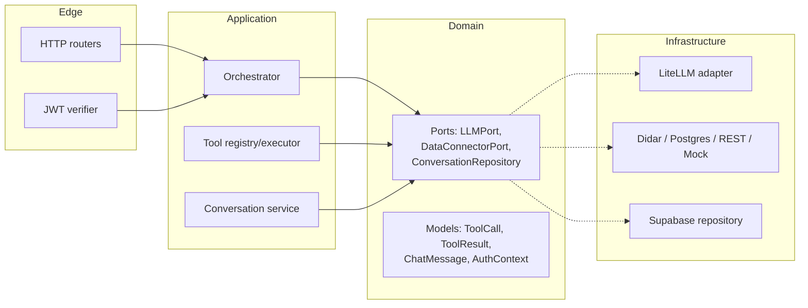
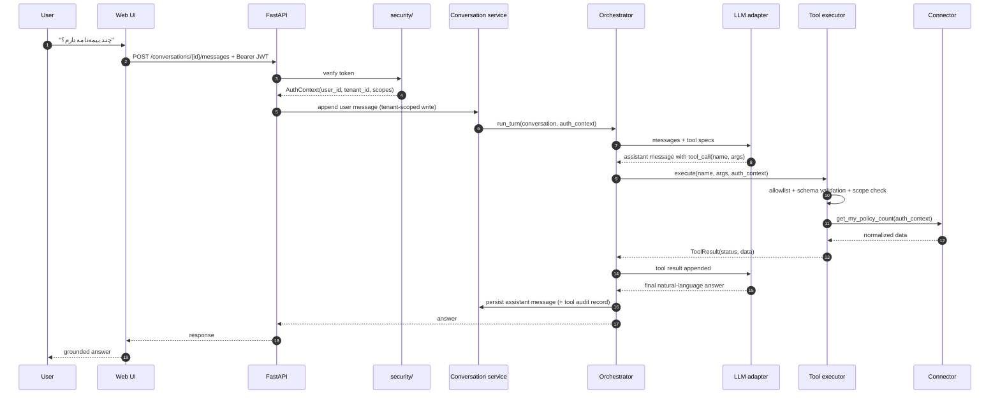

# Architecture — Enterprise AI Assistant

Status: Phase 0 (bootstrap). This document describes the **intended** system. Sections
marked *Phase N* are not implemented yet; the roadmap in `docs/ROADMAP.md` is the
schedule of record.

---

## 1. Architectural overview

The product is one web application that turns a natural-language question into a
grounded answer, using data from several independent organizational systems.

Three properties drive every structural decision below:

1. **Grounding.** Answers come from tool results, never from model memory or
   interpolation. Anything the model emits that is not traceable to a tool result is a
   defect.
2. **Server-side authority.** Identity, tenant scope, and permissions are established by
   the backend from a verified token. The model proposes; the backend authorizes and
   executes.
3. **Replaceable edges.** The LLM provider, each data connector, and the persistence
   layer are all behind ports. Swapping Gemini for another provider, or Didar24 for a
   mock, must not touch orchestration.

The system is a **modular monolith**: a single FastAPI deployable, internally divided
into modules with enforced dependency direction. There is exactly one process, one
build, one deploy target per service (api, web).



## 2. Why a modular monolith

| Driver | Consequence |
|---|---|
| Small team, educational MVP, one deploy target | one repo, one build, one runtime |
| Cross-cutting concerns (auth context, tracing, tool policy) touch every request | in-process calls instead of network boundaries |
| Cost: hosting on a free tier | one warm process instead of a fleet |
| Data sources are external; the *internal* seams are what vary | module boundaries, not service boundaries |

The seams that would become services later are already drawn as ports, so extraction is
a deployment change rather than a rewrite. What is explicitly rejected now: microservices,
message brokers, Kubernetes, per-connector services.

**Boundaries that the monolith must still respect.** Modules talk through the
application layer or through domain ports — never by importing another module's
internals. Connector code never calls the orchestrator; orchestration never issues SQL.

## 3. Ports & Adapters (hexagonal)



Rules:

- `domain/` imports no framework, no SDK, no I/O. Protocols and Pydantic models only.
- `application/` depends on `domain/` only. It receives adapters by constructor
  injection.
- `infrastructure/` depends on `domain/` and third-party SDKs. It never imports
  `application/`.
- `api/` translates HTTP to application calls and back, and owns HTTP status/error
  mapping.
- Adapters are selected at composition time (`core/dependencies.py`), which is the only
  place that knows which concrete implementation is live.

## 4. System components

| Component | Location | Responsibility | Phase |
|---|---|---|---|
| App factory / HTTP edge | `apps/api/app/main.py`, `app/api/` | lifespan, CORS, routers, error envelope | 0 |
| Settings | `app/core/config.py` | environment → typed settings | 0 |
| Composition root | `app/core/dependencies.py` | wiring, adapter selection, cached singletons | 0–2 |
| Auth context | `app/security/` | verify token, derive `AuthContext`, enforce scope | 2 |
| Conversation service | `app/application/services/` | load/store conversation, turn lifecycle | 2 |
| Orchestrator | `app/application/orchestration/` | prompt assembly, LLM loop, tool rounds | 2 |
| Tool registry / executor | `app/application/tools/` | allowlist, schema validation, authorization, timeout | 3 |
| LLM adapter | `app/infrastructure/llm/` | LiteLLM calls, provider mapping, retries | 2 |
| Connector adapters | `app/infrastructure/connectors/` | read-only retrieval, normalization to app schemas | 4 |
| Persistence adapter | `app/infrastructure/persistence/` | conversations/messages via Supabase | 2 |
| Web client | `apps/web/` | chat UI, auth screens, streaming display | 5 |

## 5. Data flow — a single question



Key points:

- Counting and aggregation happen in application code. `get_my_policy_count()` returns a
  number; the model is not asked to tally a list.
- The user identity used by the connector arrives from `AuthContext`, never from the
  model's arguments.
- The turn is persisted with enough detail to explain later *why* an answer was given.

## 6. LLM orchestration and Function Calling

Orchestration is a bounded loop, not an agent framework:

```text
assistant = llm.complete(messages, tools=registry.specs_for(auth_context))
for round in 1..MAX_TOOL_ROUNDS:
    if assistant has no tool_calls: break
    for call in assistant.tool_calls:
        result = executor.execute(call, auth_context)   # validated, authorized, timed out
        messages.append(tool_message(call.id, result))
    assistant = llm.complete(messages, tools=…)
if rounds exhausted: return a partial answer + a stated limitation
```

Guarantees the design must provide:

| Guarantee | Mechanism |
|---|---|
| No invented data | tools only; system prompt forbids answering from memory; empty result is stated, not filled in |
| No privilege escalation | tool arguments cannot name a user/tenant; identity injected from `AuthContext` |
| No unbounded cost | max tool rounds per turn, per-call timeout, token ceiling |
| No unknown tools | registry allowlist; unknown name is a validation error |
| No malformed input | Pydantic schema per tool, validated before execution |
| No silent failure | tool errors become structured `ToolResult(status=error)` the model can explain |
| Observable | every tool call logged: name, args hash, latency, status, user id, conversation id |

Model and provider are configuration (`LLM_MODEL`), and only the adapter knows the
vendor's message format. Switching provider is a settings change plus, at most, a new
adapter — never an orchestration change.

Initial tools (Phase 3) are user-scoped and deliberately narrow:

```text
get_my_policies()                  -> list of policy summaries
get_my_policy_count()              -> integer
get_policy_details(policy_id)      -> single policy, ownership enforced
get_policy_status(policy_id)       -> status, ownership enforced
```

Explicitly forbidden: `execute_sql(query)`, `fetch_url(url)`, `get_policies(user_id)`,
or any tool whose argument can widen its own scope.

## 7. Connector architecture

Three classes of retrieval, kept distinct because they have different trust and latency
profiles:

| Class | Question it answers | Mechanism | Phase |
|---|---|---|---|
| **Knowledge retrieval** | "what do our documents say?" | RAG over ingested documents | Future |
| **Structured retrieval** | "how many of my policies?" | typed repository functions over SQL | 4 |
| **Live retrieval** | "what is the status right now?" | authorized read-only REST calls | 4 |

RAG is a *future capability inside the retrieval layer*, not the architecture of the
whole system. A vector store is not required to answer a counting question, and
introducing one before there are documents to search would be cost without value.

Every connector implements the same port:

```text
protocol DataConnector:
    name: str
    async def health() -> ConnectorHealth
    async def fetch(spec: FetchSpec, ctx: AuthContext) -> ConnectorResult
```

`ConnectorResult` is an application-defined schema; vendor payloads never escape the
adapter. Each connector owns:

- its credential (read-only, least privilege, from settings);
- an explicit allowlist of queries/endpoints — not a general-purpose client;
- **validation that the requested scope matches `AuthContext`** before the call;
- normalization to application models;
- timeouts, retries with backoff on transient errors, and a typed error taxonomy.

**Didar24**: integration is unverified. Phase 1 investigates authorized options only.
No scraping, no reverse engineering, no access-control bypass. If no authorized API
exists, the demonstration uses the mock connector over synthetic data — which is also
the default for local development and tests, so that no phase depends on Didar24
availability.

## 8. Authentication and authorization boundaries

```text
Browser (untrusted)  ──────┐
                           │  Bearer JWT (Supabase)
FastAPI edge  ◄────────────┘
  verify signature (JWKS) ──▶ AuthContext(subject, tenant_id, roles, scopes)
                                 │
                                 ├─▶ persistence: tenant-scoped reads/writes
                                 ├─▶ tool executor: scope + ownership checks
                                 └─▶ connectors: query restricted to subject/tenant
```

- The frontend never asserts identity; it only carries a token.
- The LLM receives tool *results*, not credentials, and cannot name a subject.
- Connector credentials never reach the browser or the prompt.
- Database access for connectors uses dedicated read-only roles.
- A missing/invalid token is `401`; a valid token without the required scope is `403`;
  both are logged without the token value.

Detail, including tenant isolation and negative-test requirements:
`docs/architecture/SECURITY.md`.

## 9. Persistence

Application state (users, conversations, messages, tool-call audit records) lives in
Supabase/PostgreSQL. Phase 0 defines no schema beyond what Phase 2 needs; the first
migration will introduce `conversations`, `messages`, and `tool_invocations`.

The application database is **logically separate** from every connector data source:
different credentials, different schemas, no joins across the boundary. Connector data
is read through adapters, never copied into the app database for convenience.

## 10. Deployment topology (Phase 6)

```text
Render Static Site (apps/web)  ──HTTPS──▶  Render Web Service (apps/api)
        VITE_API_BASE_URL                        │
                                                 ├──▶ Supabase (managed Postgres + Auth)
                                                 └──▶ read-only external data sources
```

- api: Docker image from `apps/api/Dockerfile`, `uvicorn`, `/health` for liveness.
- web: static build (`vite build`), API base URL injected at build time.
- secrets: Render environment variables; nothing in the image.
- Free-tier limits (cold starts after idle, ephemeral filesystem, limited CPU/RAM,
  build minutes) are acceptable for a demonstration and are documented in
  `docs/architecture/TECH_STACK.md`. No uploads/state may rely on local disk.

## 11. Explicitly rejected at this stage

Microservices · Kubernetes · separate LiteLLM proxy · vector database · message queue ·
multi-agent framework · write paths to external systems · connector-management UI ·
fine-tuning · local database container for application state.
